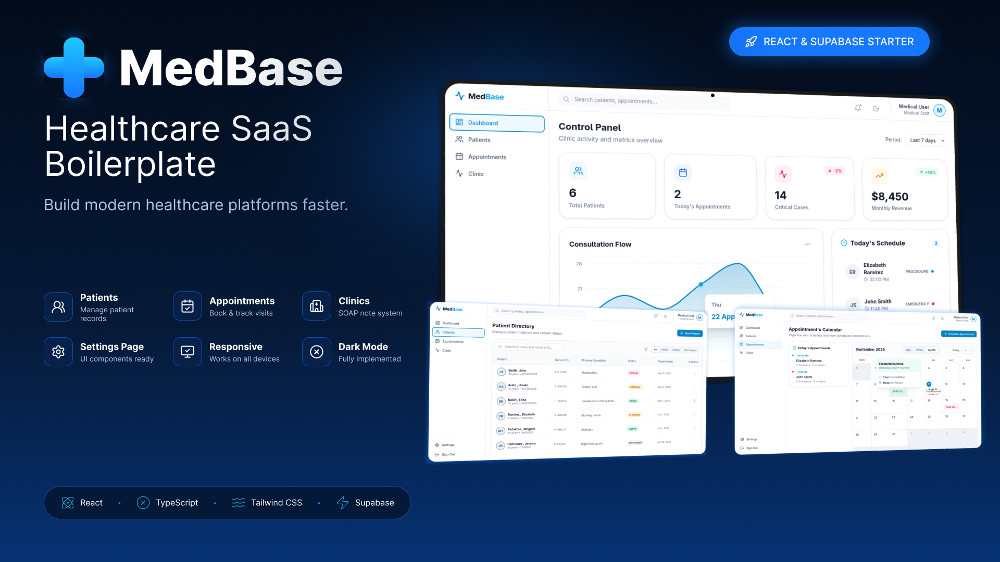

# MedBase Lite - React 19 Healthcare SaaS Boilerplate



**MedBase Lite** is an enterprise-grade boilerplate designed to accelerate the development of clinical applications, booking systems, and medical practice software. Built with React 19 and Tailwind CSS v4, this Starter Kit demonstrates a clean, Feature-Driven Architecture (FDA).

> 🚀 **Building for production?**
> This is the free, static version of the repository. To access real database mutations, secure Supabase Auth/RLS integration, calendar conflict resolution, and comprehensive form validations, upgrade to the **Pro** version at [medbase.tech](https://medbase.tech) using the code `PH20` for a 20% discount.

## ✨ Frontend Features (Lite Version)

*   **Feature-Driven Architecture (FDA):** Modular folder structure (`features/`, `services/`, `utils/`) that scales predictably.
*   **Data Simulation (Mock Data):** Structured JSON files powering the interface via (Simulated) RTK Query, showcasing the data flow without requiring a backend.
*   **Premium UI/UX:** Modern medical interface with Tailwind CSS v4, responsive components, and micro-interactions.
*   **Ready-to-use Clinical Views:** Complete templates for Dashboard, Patient Directory, SOAP Notes (Subjective, Objective, Assessment, Plan), and Clinic Settings.

## 🛠 Tech Stack (What's included in the codebase)

*   **Core:** React 19, TypeScript, Vite
*   **Styling:** Tailwind CSS v4
*   **State & Data:** Redux Toolkit + RTK Query (Simulation layer in this version)
*   **Forms:** React Hook Form + Zod (Client-side validation)
*   **Iconography & Utilities:** Lucide React, Framer Motion, React-Hot-Toast

---

## ⚖️ Version Comparison

| Feature | MedBase Lite (Open Source) | MedBase Pro (Commercial License) |
| :--- | :---: | :---: |
| **FDA Architecture & Premium UI** | ✅ | ✅ |
| **React 19 & Tailwind v4 Components** | ✅ | ✅ |
| **Patient Directory (UI)** | ✅ | ✅ |
| **Basic Calendar Engine** | ✅ Static (CSS Grid) | ✅ Drag & Drop (`@dnd-kit`) + Conflicts |
| **Real Database Connection** | ❌ Mock Data | ✅ Supabase (PostgreSQL) |
| **Authentication & RLS Security** | ❌ Omitted | ✅ Supabase Auth |
| **CRUD Mutations (Create/Edit/Delete)** | ❌ Simulated Hooks | ✅ Real Requests + Error Handling |
| **Updates & Support** | ❌ | ✅ 6 Months Included |

---

## 🚀 Quick Start (Local Installation)

1.  **Clone the repository:**
    ```bash
    git clone [https://github.com/your-username/medbase-lite.git](https://github.com/your-username/medbase-lite.git)
    cd medbase-lite
    ```

2.  **Install dependencies:**
    ```bash
    npm install
    ```

3.  **Start the development server:**
    ```bash
    npm run dev
    ```

4.  Open `http://localhost:5173` in your browser to explore the static UI.

## 🤝 Support and Customization

Looking for a custom implementation for your clinic, agency, or healthcare startup? At **Xappable Studios** we offer full-stack development and SaaS architecture services based on MedBase[cite: 1, 2]. 

Contact us at [hello@xappablestudios.com](mailto:hello@xappablestudios.com) or visit our [official website](https://xappablestudios.com)[cite: 1, 2].

## 📄 License

This repository (MedBase Lite) is licensed under the **MIT** terms. You are free to study the interface and build upon it. 

To utilize the backend logic, interactive calendar system, and database mutations, a **Commercial License** is required, available at [medbase.tech](https://medbase.tech).